# Smart Environment

**A cross-platform dashboard that turns live room-sensor data into information people can act on at a glance.**
Temperature, humidity, light, noise, pressure, air quality and staff location, on iOS, Android and the web from one codebase.


<p align="center">
  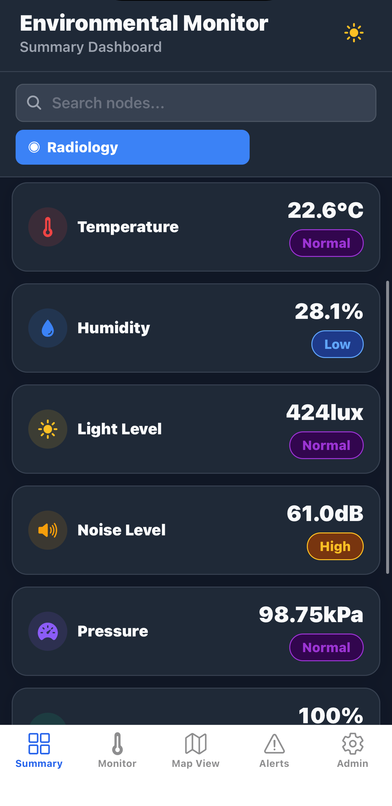
  &nbsp;
  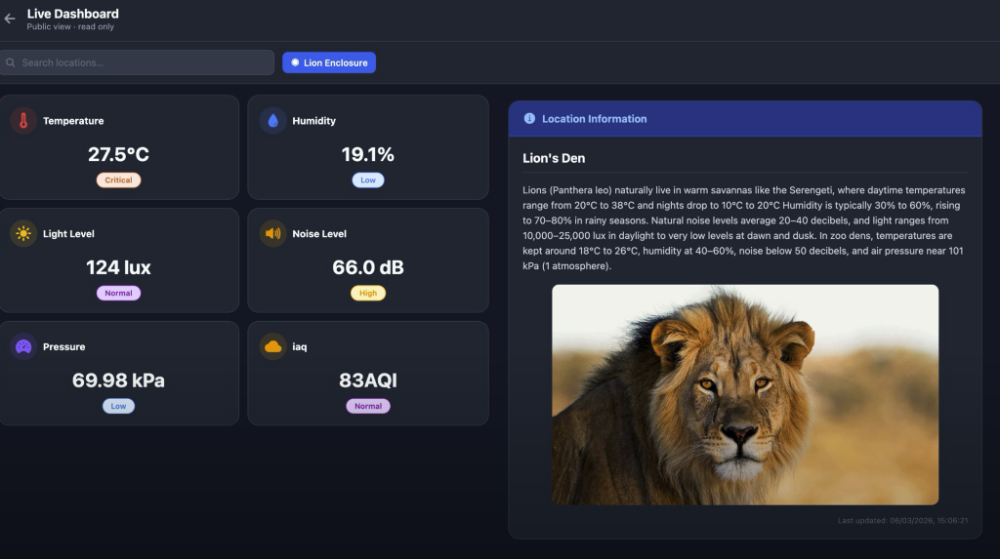
</p>

**My role:** Lead frontend developer and UX designer in a 4-person team. I owned the app's UI design, the React Native frontend, accessibility, internationalisation and user testing. The sensor hardware, backend API and Grafana dashboards were built by teammates.

**Context:** Lancaster University group project (SCC312) · 3 Agile sprints · Jan–Mar 2026

> [!NOTE]
> **Why there's no live link:** the app reads from physical sensor nodes, so it only shows data while the hardware network is running. The screenshots and recording below were captured from the working system.

---

## The problem

The people responsible for a space, such as a hospital ward manager, need to know right away if conditions are drifting out of a safe range. Raw sensor dashboards are built for engineers: they're dense, full of graphs and slow to read during a busy shift. Our system had to work for these non-technical users and also be easy to adapt to other spaces, such as a zoo or a museum.

## What it does

- **Summary dashboard:** every sensor reading for a room on one screen, with colour + text status badges, battery health and the number of staff in the room
- **Historical analytics:** charts for 8 sensors over 6 hours, 24 hours, 7 days or 30 days, with safe-range lines and plain-language summaries
- **Live floor plan:** where staff are now, plus their location history
- **Admin tools:** editable alert thresholds per sensor and room, admin account creation, language switching
- **Public Information Board:** an optional public screen (for example, a zoo enclosure sign) that shows only the readings the admin chooses to share

<p align="center">
  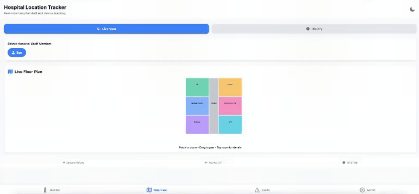
  <br><sub>Live floor plan, recorded with the sensor network running</sub>
</p>

---

## Design process

### Information architecture

Two audiences, two clear paths from the first screen: the public see a read-only view with no login, and staff sign in to get the full toolset.

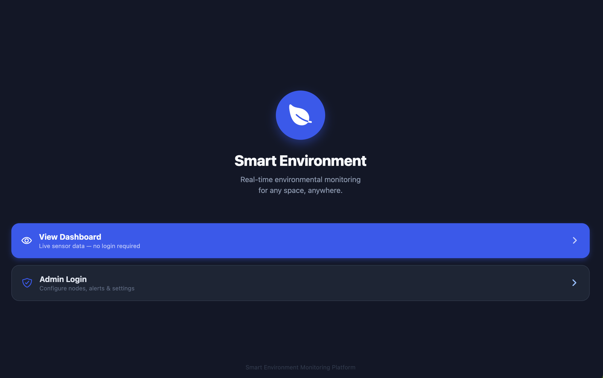

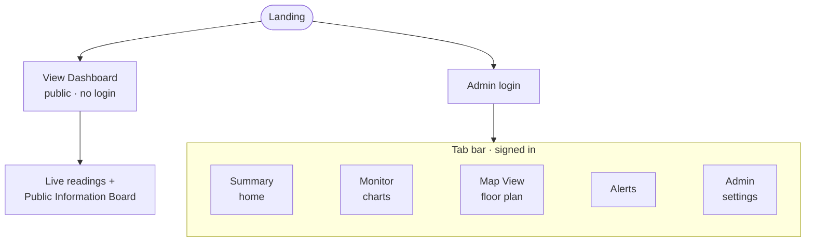

### Key design decisions

| Problem | What I designed | Principle |
|---|---|---|
| Managers had to click through 4 screens to get the overall picture (demo feedback) | A **Summary dashboard** as the home screen, with compact status cards and badges instead of graphs. If everything is fine, the page is calm. | Visibility of system status |
| A 24-hour chart drew 288 data-point dots, which turned into a smear on phones | **Removed the point markers**, showed only key time labels and kept 3 gridlines: min threshold, midpoint, max threshold | Aesthetic and minimalist design |
| A row of room buttons wouldn't scale to hundreds of rooms | A **searchable room selector**, built the same way on all 5 screens and filtered with `useMemo` | Consistency · Flexibility and efficiency |
| Screen readers said nothing useful about the charts | **Tap-to-summarise**, for example: *"Temperature over the last 24 hours. Range 18.2–23.7°C. Average 21.4°C. 3 periods exceeded 22°C."* | Recognition over recall · WCAG 2.1 |
| Red/green status badges don't work for people with red-green colour blindness | **Blue = normal, amber = warning, purple-red = critical**, always paired with a text label. Contrast checked to 4.5:1. | WCAG 1.4.1 · 1.4.3 |
| Thresholds were hard-coded for one hospital ward | Admins can **edit min, max and critical values** per sensor per room, and the charts update straight away | Generalisability |

<details>
<summary><b>Why a minimalist visual style?</b></summary>
<br>

I questioned this halfway through the project, because other teams were building more decorative, domain-themed interfaces. I kept the minimalist style on purpose:

- **The audience is doing a job.** Facilities managers and admins need to read data quickly, and decoration adds cognitive load without adding information (Tufte's *data-ink* principle).
- **A neutral design works anywhere.** A leaf-and-green theme suits a greenhouse but would feel wrong in a hospital, so a neutral UI doesn't need re-skinning for each deployment.
- **Personality goes in the content.** The Public Information Board lets each organisation add its own title, text and image. The system provides a neutral frame, and the deployment gives it a voice.

</details>

### User research

I planned and ran a task-based usability study with 5 participants, covering every major feature.

- Every participant gave **"easy to navigate" 5/5**. "Sensor readings are easy to interpret" averaged **4.6/5**.
- Task ease scores were 7.8–9.8 out of 10, **except map drag-and-drop at 5.2**.

The study found three issues that none of us had caught in developer testing:

| Issue | Fix |
|---|---|
| Threshold inputs needed two taps before you could type | I fixed the focus handling so one tap focuses and activates the input |
| Dragging rooms on the map was hard (5.2/10): the hit areas were small and the gesture clashed with scrolling | Changed to tap-to-place with clearer visual cues (built by a teammate). Follow-up testing confirmed the improvement. |
| The live map and the history view were visible at the same time, so it was unclear which mode was active | Made the two views mutually exclusive |

<details>
<summary>Average usability score by task</summary>
<br>
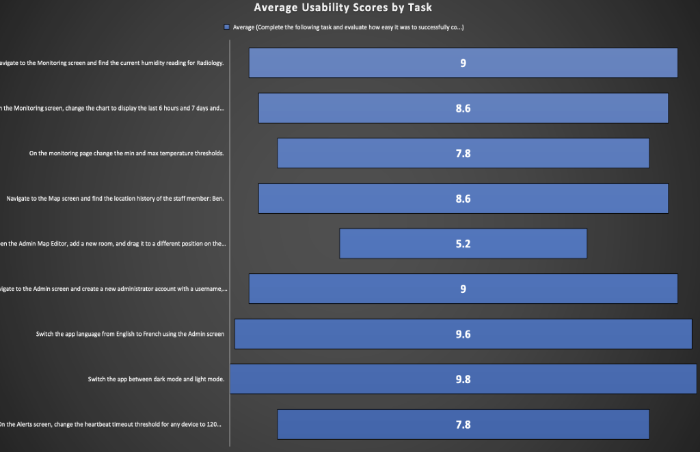
</details>

### Accessibility and inclusion

- Targeted **WCAG 2.1 AA** and tested with **VoiceOver** on iOS. Charts have `accessibilityRole="image"` and labels.
- **Internationalised** in English, French and Spanish with i18next. The app detects the device language on first launch, and the in-app language choice is saved between sessions.
- Colour is never the only signal: every status has a text label or an icon.

---

## Screenshots

**One codebase, phone and laptop.** Below a 768px breakpoint the cards stack in one column. Above it, they use a two-column grid.

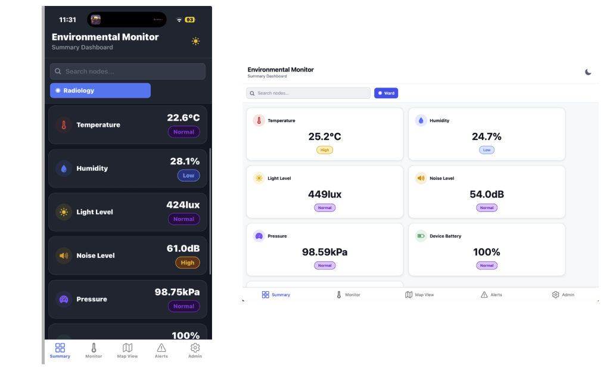

**Public Information Board:** the admin editor (left) and the public display it produces (right). Admins choose which sensors are public for each location and can switch the board off entirely, for example in a hospital where readings shouldn't be public.

<table>
  <tr>
    <td width="50%">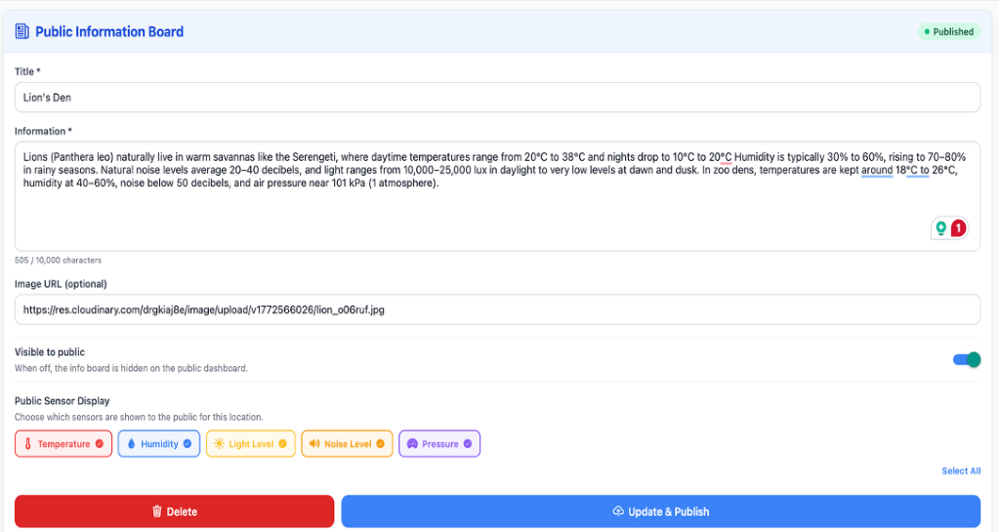</td>
    <td width="50%"></td>
  </tr>
</table>

**Admin tools:** editable thresholds and the language switcher (shown in Spanish).

<table>
  <tr>
    <td width="50%">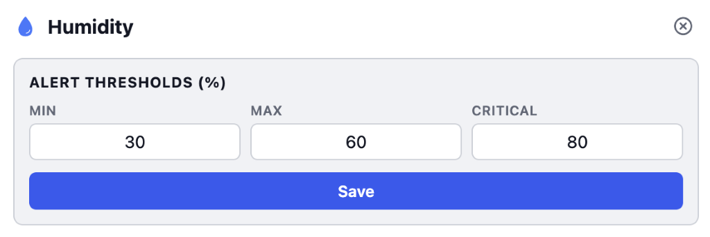</td>
    <td width="50%">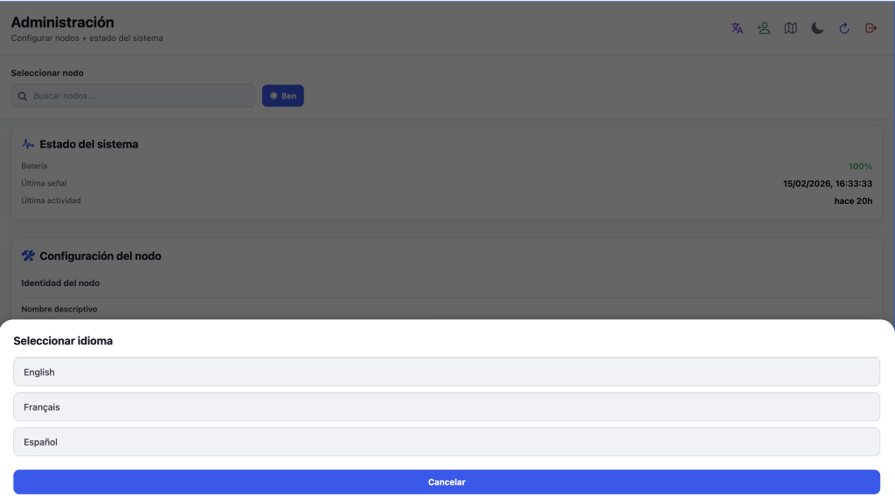</td>
  </tr>
</table>

**Clear feedback:** a wrong password and a network failure show different messages, so users know whether to retry their password or check their connection.

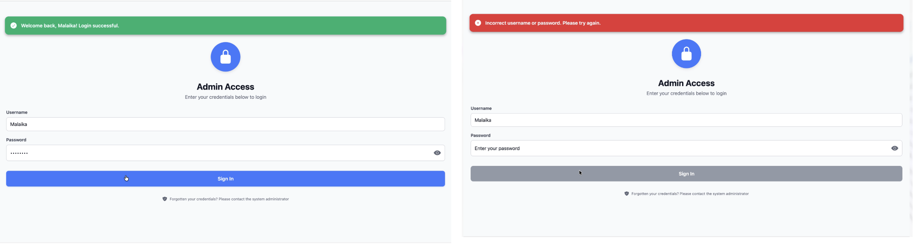

---

## Architecture

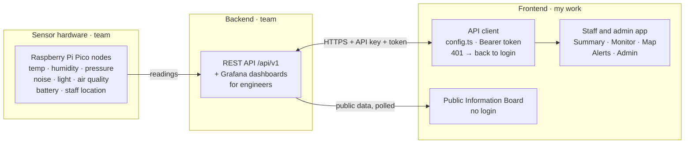

- **One codebase, three platforms.** I chose React Native with Expo at the start. When I did the responsive work later, every fix reached iOS, Android and the web at the same time.
- **Responsive layouts** use `useWindowDimensions()` with a 768px breakpoint. I tested at 360, 390, 768, 1024 and 1440px and on four physical phones. A Samsung phone with display scaling turned on caused chart labels to overflow, which I fixed with explicit font sizes.
- **Central config:** I moved the backend URL out of 5 separate files into a single `config.ts`, so the app can be pointed at a new deployment by changing one line.

<details>
<summary><b>Authentication flow</b></summary>
<br>

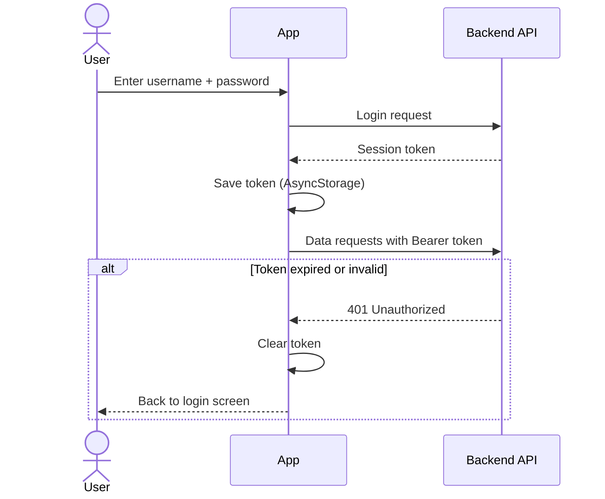

New admin accounts can only be created from inside the admin panel by an admin who is already signed in. The backend checks that admin's token and role before creating the account. If account creation fails, the current user is signed out. That's a deliberate trade-off: the system holds staff location data, so the extra safety is worth a little friction.

</details>

## Tech stack

| Layer | Tech | Why |
|---|---|---|
| App | React Native, Expo, TypeScript | One codebase for iOS, Android and web |
| Charts | react-native-chart-kit | Charting library for React Native (D3 doesn't run natively) |
| Languages | i18next, react-i18next, expo-localization | Translations plus automatic device-language detection |
| Storage | AsyncStorage | Saves the session token and language choice |
| Backend | REST API, Grafana | Built by teammates |
| Hardware | Raspberry Pi Pico sensor nodes | Built by teammates |
| Process | Scrum, Notion board | 3 sprints with a demo at the end of each |

## Running it locally

```bash
npm install
npx expo start      # press w for web, or scan the QR code with Expo Go
```

Set the backend address in `config.ts`. Without the sensor network running, the screens load but show no readings.

---

## What I learned

- **Developer testing isn't user testing.** The usability study found three real issues that none of us had noticed, because we already knew how the app was supposed to work. Next time I'd test with users in the first sprint.
- **Internationalisation is engineering, not just translation.** Adding Mandarin broke text measurement inside fixed-size cards, so I left it out rather than ship a broken version. Now I check what a script needs before committing to it.
- **Test on real devices early.** Several layout bugs only showed up on physical phones, never in the browser simulator.

**Next steps:** a demo mode with simulated sensor data so the app can be deployed publicly, per-environment `.env` config, and Mandarin support.

## Contact

[Portfolio](https://your-site) · [LinkedIn](https://linkedin.com/in/your-profile) · your@email.com
